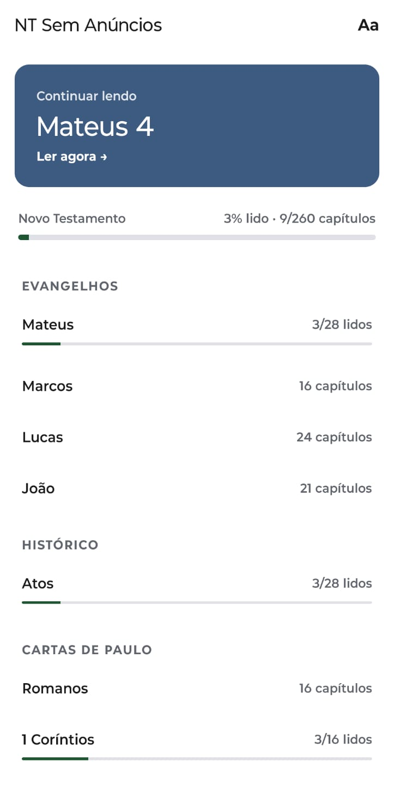
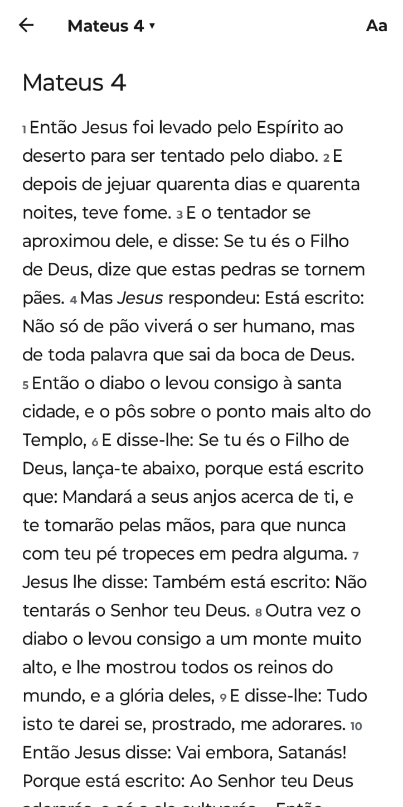
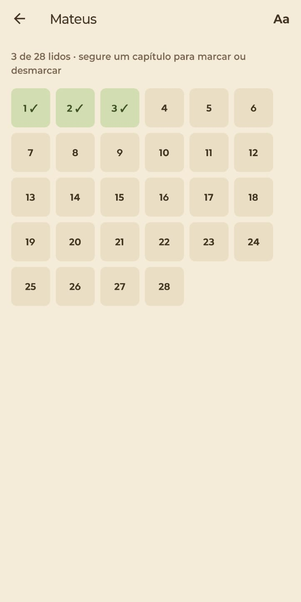
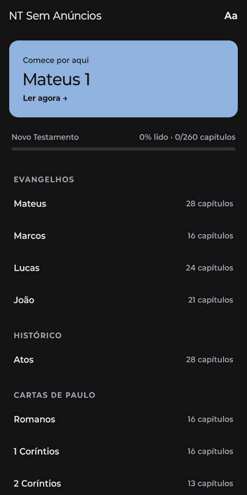

<p align="center">
  
</p>

<h1 align="center">Novo Testamento Sem Anúncios</h1>

<p align="center">
  App Android de leitura do Novo Testamento — <b>sem anúncios, sem login, sem rastreamento e 100% offline</b>.
  <br/>
  <!-- PLAY_STORE_LINK: trocar pelo badge da loja quando sair para produção -->
  <i>Em teste fechado na Google Play · produção em breve</i>
</p>

<p align="center">
  
  
  
  
</p>

> 🇺🇸 *A free, offline, ad-free and tracker-free New Testament reader for Android, built with React Native (Expo) and TypeScript. Zero network permissions, local-only storage, published on Google Play.*

## Por que existe

Todo app bíblico gratuito que encontrei tinha anúncios, exigia conta ou coletava dados. Este é o oposto: abre e lê. Projeto sem fins lucrativos.

## Funcionalidades

- 27 livros (Mateus a Apocalipse), capítulos com deslize lateral e "continuar de onde parei"
- Busca em todo o NT, sem diferenciar acentos e maiúsculas, com destaque do versículo encontrado
- Marcação de capítulos lidos, progresso por livro e geral
- Ofensiva de leitura (dias seguidos, com folga semanal) e lembrete diário opcional
- "Para momentos de…": versículos selecionados por tema
- Temas claro, sépia e escuro; fonte serifada (Literata), sem serifa (Atkinson Hyperlegible) ou a do sistema; tamanho ajustável
- Copiar e compartilhar versículos com a referência

## Privacidade como requisito de engenharia

- **Nenhuma permissão de rede.** O `app.json` bloqueia `INTERNET` e as permissões padrão que o Expo injeta (armazenamento, `AD_ID`, `SYSTEM_ALERT_WINDOW`…), e o manifesto final de cada build é conferido
- O texto vai empacotado no app; tudo o que o usuário gera (posição, lidos, preferências) fica só no aparelho (`expo-sqlite/kv-store`)
- Formulário de segurança de dados da Play Store: **não coleta dados**

## Stack e arquitetura

| Camada | Tecnologia |
|---|---|
| App | React Native 0.86 + React 19, **TypeScript**, Expo SDK 57 |
| Navegação | expo-router (rotas por arquivo: `/[livro]/[cap]`) |
| Persistência | expo-sqlite (kv-store) |
| Notificações | expo-notifications (somente locais) |
| Build/distribuição | EAS Build (`.aab`), Google Play Console (teste interno → fechado → produção) |
| Tooling | Node.js (scripts de dados e ícones), sharp, ESLint |

```
src/
├── app/          # telas (expo-router): início, leitura, capítulos, busca, temas, ajustes, sobre
├── lib/          # lógica pura e testável: livros, busca, citação, lidos, ofensiva, lembrete…
├── components/   # UI reutilizável (temas, barra de progresso, seletor)
└── hooks/        # tema e fonte de leitura
scripts/
├── converter-blivre.mjs   # fonte VPL → um JSON por livro, validando 27 livros / 260 caps / 7957 versículos
├── conferir-temas.mjs     # valida as referências da curadoria temática
└── gerar-icones.mjs       # ícone adaptativo, monocromático, splash e favicon
```

**Decisões de destaque**
- A lógica de domínio (busca, ofensiva, posição de leitura) fica em módulos puros, sem dependência de React Native, testados no Node com o texto real
- Os dados são gerados por script e validados a cada execução, em vez de editados à mão
- O texto é carregado sob demanda, um JSON por livro, para manter a abertura rápida

## Rodando localmente

```bash
npm install
npx expo start      # abrir no Expo Go
npx tsc --noEmit && npx expo lint
```

## Créditos e licenças

Texto bíblico: **A Bíblia Livre (BLIVRE)**, CC BY 3.0 BR. Fontes Literata e Atkinson Hyperlegible sob a SIL OFL 1.1. Detalhes em [CREDITOS.md](CREDITOS.md).
O código-fonte está publicado para consulta e portfólio, com todos os direitos reservados.

## Autor

**Henrique Porzelt Neto** — desenvolvedor full stack (PHP/Laravel, Vue, React Native)
[LinkedIn](https://linkedin.com/in/henriqueporzelt) · [GitHub](https://github.com/Porzelt)
